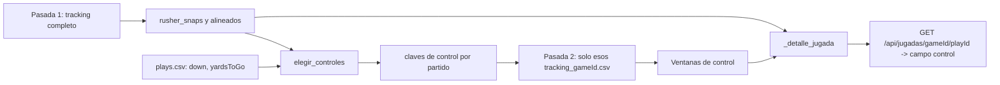

# Design Document

## Overview

La selección de la Jugada_Control usa solo datos que ya están en memoria tras la primera lectura (Rusher_Alineado con `s`, `down`, `offside`, y `yardsToGo` de `plays.csv`). Con las claves elegidas se hace una segunda pasada sobre los archivos de tracking de esos partidos (como máximo uno por Jugada_Offside) para obtener sus Ventanas. El detalle de la control se arma con la misma función que el detalle de la Jugada_Offside.

## Architecture



## Components and Interfaces

`backend/offside_service.py`
- `elegir_controles(rusher_snaps, alineados, plays) -> dict[(g, p), dict]`: para cada Jugada_Offside devuelve `{"clave": (g_c, p_c), "distancia_situacion": int, "criterio": str}` o no la incluye si no hay candidata.
- `leer_ventanas(data_dir, claves) -> (DataFrame, list[int])`: segunda pasada; reutiliza `_leer_tracking(ruta, claves)` solo en los archivos de los `gameId` de `claves`; devuelve las ventanas y los `gameId` que fallaron.
- `_detalle_jugada(...)`: función común que arma `linea_golpeo_x`, `frames` y `velocidad` de una jugada dado el `nflId` a resaltar. La usan `construir_jugadas` y la control.
- `cargar_datos` agrega `data_dir` al diccionario de datos para la segunda pasada.

Criterio (texto): `"Mismo jugador[, mismo partido], <down> y <distancia>, quieto en el snap (<s> yd/s)"`.

`dashboard/src`
- `components/VisorJugada.tsx`: línea de tiempo común = unión ordenada de los `t` de ambas jugadas; un índice sobre esa línea de tiempo.
- `components/Campo.tsx`: recibe `t` y dibuja el cuadro con el `t` más cercano.
- `components/GraficaVelocidad.tsx`: une las dos series por `t` en tres líneas.

## Data Models

```python
class JugadaControl(JugadaResumen):
    linea_golpeo_x: float
    frames: list[Frame]
    velocidad: list[PuntoVelocidad]
    distancia_situacion: int
    criterio: str

class JugadaResumen(BaseModel):     # campo nuevo
    tiene_control: bool = False

class JugadaDetalle(JugadaResumen):  # campo nuevo
    control: JugadaControl | None = None
```

## Error Handling

| Situación | Comportamiento |
|---|---|
| Infractor sin Candidata_Control | `control = null`, `tiene_control = false` |
| Archivo de la segunda pasada ilegible | `control = null` en las jugadas de ese partido; el `gameId` se registra |
| Datos cargados sin `data_dir` (pruebas con datos en memoria) | `control = null` |
| Dashboard: jugada sin control | Solo la cancha con offside y un aviso |

## Correctness Properties

### Property 1: Validez de la control
For any Jugada_Offside con control, la Jugada_Control es otra jugada del mismo `nflId`, el jugador es Rusher_Alineado en ella, no tiene Offside_Ligado y su Velocidad_Snap es ≤ 0.25.

**Validates: Requirements 1.1, 1.2**

### Property 2: Optimalidad y desempate
For any conjunto de candidatas, ninguna otra Candidata_Control tiene menor Distancia_Situacion, y entre empates se respeta el orden: mismo partido, menor `s`, menor `gameId`, menor `playId`.

**Validates: Requirements 1.1, 1.4**

### Property 3: Formato del detalle de control
For any control, `frames` cumple las propiedades 2 y 3 de `jugada-evidencia` (ventana con exactamente un `t == 0`, como máximo un infractor y un balón por cuadro).

**Validates: Requirements 2.1, 2.3, 2.4**

## Testing Strategy

Pruebas pytest con datos sintéticos para las propiedades 1 a 3, la ausencia de candidata (`control = null`) y un archivo de la segunda pasada ilegible. Prueba con datos reales: las 48 Jugada_Offside tienen control.
