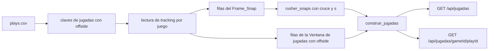

# Design Document

## Overview

Se extiende la carga de `offside-endpoint`: mientras se lee cada `tracking_<gameId>.csv`, además de las filas del Frame_Snap se guardan las filas de la Ventana de las jugadas que tienen un `Defensive Offside` en `foulName1`/`foulName2` (se conocen antes de leer el tracking porque `plays.csv` se lee primero). Con eso se arma una lista de resúmenes y un diccionario `(gameId, playId) -> detalle`, ambos en memoria.

## Architecture



## Components and Interfaces

`backend/offside_service.py`
- `claves_offside(plays) -> set[tuple[int, int]]`: jugadas con `Defensive Offside` en `foulName1` o `foulName2`.
- `_leer_tracking(ruta, claves) -> (snap_rows, ventana_rows)`: una sola lectura por archivo.
- `normalizar(x, y, play_direction)`: Coordenadas_Normalizadas.
- `construir_jugadas(datos, rusher_snaps) -> (lista, detalles)`: arma resúmenes ordenados y detalles.

`backend/main.py`
- `GET /api/jugadas` → lista.
- `GET /api/jugadas/{game_id}/{play_id}` → detalle o 404.
- Ambas usan el mismo control de estado (`calculando`/`error`/`listo`) que `/api/offside`.

`dashboard/src`
- `api.ts`: `cargarJugadas()`, `cargarJugada(gameId, playId)`.
- `components/VisorJugada.tsx`: selector, resumen, controles y `Campo` + `GraficaVelocidad`.
- `components/Campo.tsx`: SVG con `viewBox` de 30 yardas alrededor de la línea de golpeo (`linea_golpeo_x - 12` a `+18`) por 53.3 de ancho.
- `components/GraficaVelocidad.tsx`: `LineChart` con `ReferenceLine x={0}`.

## Data Models

```python
class JugadorFrame(BaseModel):
    nflId: int | None
    x: float
    y: float
    s: float | None
    numero: int | None
    rol: str          # infractor | defensa | ofensiva | balon

class Frame(BaseModel):
    frameId: int
    t: float
    jugadores: list[JugadorFrame]

class PuntoVelocidad(BaseModel):
    t: float
    infractor: float | None
    resto_linea: float | None

class Infractor(BaseModel):
    nflId: int
    nombre: str

class JugadaResumen(BaseModel):
    gameId: int
    playId: int
    infractor: Infractor
    equipo_defensa: str
    equipo_ofensiva: str
    quarter: int
    down: int
    yardsToGo: int
    gameClock: str
    s_snap: float
    cruce_snap: float
    alineado: bool
    descripcion: str

class JugadaDetalle(JugadaResumen):
    linea_golpeo_x: float
    frames: list[Frame]
    velocidad: list[PuntoVelocidad]
```

Rol de cada fila: `team == "football"` → `balon`; `nflId == infractor` → `infractor`; `team == defensiveTeam` → `defensa`; el resto → `ofensiva`.

## Error Handling

| Situación | Comportamiento |
|---|---|
| Cálculo en curso o fallido | 503 con `estado`, igual que `/api/offside` |
| Jugada inexistente o sin offside | 404 `{"detail": "No hay una jugada con offside con ese gameId y playId."}` |
| Infractor sin fila en un cuadro | Ese cuadro no lo dibuja; `velocidad.infractor = null` |
| Jugada sin Resto_Linea | `resto_linea = null` |
| Dashboard: fallo de lista o detalle | Mensaje en español dentro del Visor |

## Correctness Properties

### Property 1: Normalización
For any `x` en `[0, 120]`, `y` en `[0, 53.3]` y dirección, normalizar dos veces con `left` devuelve el punto original, y con `right` no cambia el punto.

**Validates: Requirements 2.4**

### Property 2: Ventana
For any detalle, los `frameId` de `frames` son crecientes, están entre `Frame_Snap - 15` y `Frame_Snap + 20`, y existe exactamente un cuadro con `t == 0`.

**Validates: Requirements 2.3**

### Property 3: Roles
For any cuadro, hay como máximo un jugador con `rol == "infractor"` y como máximo una fila con `rol == "balon"`.

**Validates: Requirements 2.4**

### Property 4: Orden de la lista
For any lista, `s_snap` es no creciente.

**Validates: Requirements 1.3**

## Testing Strategy

Pruebas pytest en `backend/tests/` con datos sintéticos para las propiedades 1 a 4 y pruebas de la API con `TestClient` (200 en lista y detalle, 404 en jugada inexistente, 503 mientras calcula).
