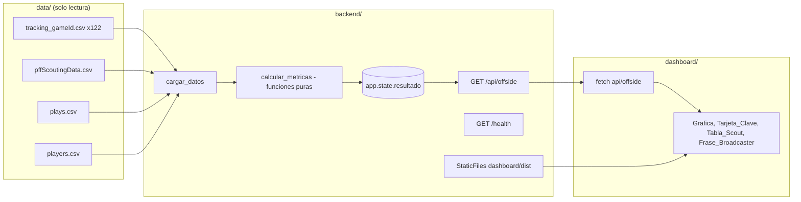

# Design Document

## Overview

La función expone `GET /api/offside` y un tablero React que relaciona la velocidad de los pass rushers en el snap con los offsides defensivos. Todo se calcula una sola vez al arrancar el servidor, a partir de los CSV de solo lectura en `data/`, y se guarda en memoria. Las peticiones solo serializan el resultado precalculado. No se escribe a disco, no se usa IA ni servicios de AWS.

Decisiones principales:

- Un módulo puro `backend/offside_service.py` con funciones sin I/O (testeables con datos sintéticos) y una función de carga que lee los CSV.
- `backend/main.py` carga el servicio en el evento `lifespan` de FastAPI, guarda el resultado (o el error) en `app.state` y sirve `dashboard/dist` con `StaticFiles` en la misma URL y puerto.
- El frontend es una sola página que hace `fetch('api/offside')` y renderiza una gráfica Recharts, una tarjeta, una tabla y una frase.
- Solo se usan las dependencias del stack fijo: pandas 2.2.3, numpy 2.1.3, FastAPI 0.115.14, React 18.3.1, Recharts 3.10.1, Tailwind 3.4.19.

Los números de referencia previos (36,263 rusher-snaps, etc.) no se codifican. Todo valor mostrado sale de los datos.

## Architecture



Flujo de arranque (`lifespan`):

1. `lifespan` marca `app.state.estado = "calculando"`, lanza un hilo daemon con el cálculo y hace `yield` de inmediato (Requirement 10). `/health` responde desde el primer segundo.
2. En el hilo: `resolver_data_dir()` busca dentro de `RAIZ / "data"` la primera carpeta (orden alfabético, máximo 4 niveles) que tenga `plays.csv` y `tracking/`. Si no existe, `DatosNoDisponibles`.
3. Leer `pffScoutingData.csv`, `plays.csv`, `players.csv`. Si alguno falta o no se lee, registrar el error (sin credenciales) y guardar `app.state.estado = "error"` con el mensaje.
4. Por cada `tracking_<gameId>.csv`, leer solo las columnas necesarias; si falla, registrar el `gameId` y continuar.
5. Calcular las métricas, guardarlas en `app.state.resultado` y marcar `app.state.estado = "listo"`.

Las rutas de datos consultan `app.state.estado`: `"calculando"` → 503 con `Retry-After: 5`; `"error"` → 503; `"listo"` → 200.

Memoria: se procesa un juego a la vez. De cada archivo de tracking solo se conservan las filas del Frame_Snap (rushers y balón), no el tracking completo.

Orden de rutas en `main.py`: primero `/health` y `/api/...`, al final `app.mount("/", StaticFiles(directory=dist, html=True))` solo si `dashboard/dist` existe, para que el montaje no tape la API.

## Components and Interfaces

### Backend

`backend/main.py`
- `cargar_env()` con el código fijado por las reglas, llamado antes de usar boto3 (no se usa boto3 aquí, pero se conserva el bloque que ya exige el contrato si existe en el archivo actual).
- `app = FastAPI(lifespan=...)`.
- `GET /health` devuelve `{"status": "ok"}`.
- `GET /api/offside` devuelve `app.state.resultado` o `HTTPException(503, detail=mensaje)`.

`backend/offside_service.py` (funciones puras salvo `cargar_datos`):

```python
RANGOS_ETIQUETAS = ["0-0.25", "0.25-0.5", "0.5-1", "1-2", ">2"]
RANGOS_BINS = [-0.01, 0.25, 0.5, 1, 2, 10]
UMBRAL_CLAVE = 0.5      # s > 0.5
UMBRAL_SCOUT = 1.0      # s >= 1.0
MIN_SNAPS_SCOUT = 100
CRUCE_MIN, CRUCE_MAX = -1.5, 0.5

def cargar_datos(data_dir: Path) -> dict:
    """Lee los CSV (solo lectura). Lanza DatosNoDisponibles si falta un archivo requerido."""

def frame_snap(tracking: pd.DataFrame) -> pd.DataFrame:
    """Una fila por (gameId, playId) con frameId del evento ball_snap/autoevent_ballsnap."""

def rushers_en_snap(tracking_snap: pd.DataFrame, pff: pd.DataFrame) -> pd.DataFrame:
    """Rusher_Snap: pff_role == 'Pass Rush', con posicion en Frame_Snap, jugadas con balon.
    Columnas: gameId, playId, nflId, x, s, bx, playDirection."""

def calcular_cruce(x, bx, play_direction) -> float:
    """(x - bx) * signo; signo = -1 si 'right', +1 si 'left'."""

def es_alineado(cruce) -> bool:       # -1.5 <= cruce <= 0.5
def rango_velocidad(s: pd.Series) -> pd.Series:   # pd.cut(..., right=True)

def ligar_offsides(rusher_snaps: pd.DataFrame, plays: pd.DataFrame) -> pd.DataFrame:
    """Left join; agrega columna offside (0/1) segun foulName1/foulNFLId1 y foulName2/foulNFLId2."""

def metricas_por_rango(alineados: pd.DataFrame) -> list[dict]
def metricas_por_down(alineados: pd.DataFrame) -> list[dict]
def top10_scout(alineados: pd.DataFrame, players: pd.DataFrame) -> list[dict]
def numero_clave(alineados: pd.DataFrame) -> dict
def calcular_metricas(...) -> dict      # arma la respuesta completa
```

Detalles de cálculo:

- `Offside_Ligado`: `(foulName1 == "Defensive Offside") & (nflId == foulNFLId1)` o `(foulName2 == "Defensive Offside") & (nflId == foulNFLId2)`. `foulName3` no se revisa. Se calcula como columna booleana por fila de `plays` unida por `(gameId, playId)`; los rusher-snaps sin coincidencia tienen 0 (left join con `fillna(0)`).
- `pct_presion`: `((pff_hit.fillna(0) + pff_hurry.fillna(0) + pff_sack.fillna(0)) > 0).mean() * 100`.
- Para `float`, se convierten los `NaN` a `None` antes de serializar para que el JSON sea válido (`null`).
- Los `nflId` y `foulNFLId*` se comparan como enteros (`Int64`) para evitar fallos por `float`.

### Frontend (`dashboard/`)

- `src/api.ts`: `export async function cargarOffside(): Promise<OffsideResponse>` con `fetch('api/offside')`; lanza error si `!res.ok`.
- `src/App.tsx`: estados `datos`, `error`, `cargando`. Muestra mensaje en español si falla y deja el resto de la página funcional.
- `src/components/GraficaRangos.tsx`: `BarChart` de Recharts con `offsides_por_1000` por rango en el orden fijo de `RANGOS_ETIQUETAS`.
- `src/components/TarjetaClave.tsx`: texto "X% de los snaps → Y% de los offsides" y la etiqueta del umbral recibida en la respuesta.
- `src/components/TablaScout.tsx`: tabla con nombre, `rusher_snaps`, % en movimiento, `pct_presion`, `offsides` y la etiqueta "s >= 1.0 yd/s".
- `src/frase.ts`: `construirFrase(datos): string`, función pura que arma la Frase_Broadcaster con valores de la respuesta (maneja `null`).
- `vite.config.ts`: `base: './'` y `server.proxy['/api'] = 'http://localhost:8000'`.
- Tailwind 3 con `tailwind.config.js` y `@tailwind base/components/utilities` en `index.css`. Sin sintaxis de Tailwind 4.
- Todas las rutas de imágenes, CSS y enlaces son relativas y sin diagonal inicial.

### Contrato de la API

`GET /api/offside` → 200:

```json
{
  "rangos": [
    {"rango": "0-0.25", "rusher_snaps": 0, "offsides": 0, "offsides_por_1000": null, "pct_presion": null}
  ],
  "numero_clave": {
    "x_pct_snaps": 0.0, "y_pct_offsides": null, "umbral": "s > 0.5 yd/s"
  },
  "top10_scout": {
    "umbral": "s >= 1.0 yd/s",
    "jugadores": [
      {"nflId": 0, "nombre": "", "rusher_snaps": 0, "pct_movimiento": 0.0, "pct_presion": 0.0, "offsides": 0}
    ]
  },
  "por_down": [
    {"down": 1, "rusher_snaps": 0, "offsides": 0, "offsides_por_1000": null, "pct_del_total": null}
  ],
  "totales": {"rusher_snaps": 0, "offsides": 0, "juegos_omitidos": [],
              "sin_down_valido": {"rusher_snaps": 0, "offsides": 0}},
  "nota_umbrales": "El Número_Clave usa s > 0.5 yd/s y el Top_10_Scout usa s >= 1.0 yd/s por decisión deliberada."
}
```

`GET /api/offside` → 503 con `{"detail": {"estado": "calculando" | "error", "mensaje": "<texto>"}}` mientras se calcula o si falta o no se puede leer un archivo requerido. La misma nota de umbrales se documenta en el README.

## Data Models

Modelos Pydantic 2.11.7 para validar y documentar la respuesta (`response_model`):

```python
class Rango(BaseModel):
    rango: str
    rusher_snaps: int
    offsides: int
    offsides_por_1000: float | None
    pct_presion: float | None

class NumeroClave(BaseModel):
    x_pct_snaps: float | None
    y_pct_offsides: float | None
    umbral: str

class JugadorScout(BaseModel):
    nflId: int
    nombre: str
    rusher_snaps: int
    pct_movimiento: float
    pct_presion: float
    offsides: int

class Top10Scout(BaseModel):
    umbral: str
    jugadores: list[JugadorScout]

class PorDown(BaseModel):
    down: int                       # 1..4, siempre las cuatro entradas
    rusher_snaps: int
    offsides: int
    offsides_por_1000: float | None
    pct_del_total: float | None

class SinDownValido(BaseModel):
    rusher_snaps: int
    offsides: int

class Totales(BaseModel):
    rusher_snaps: int
    offsides: int
    juegos_omitidos: list[int]
    sin_down_valido: SinDownValido

class OffsideResponse(BaseModel):
    rangos: list[Rango]
    numero_clave: NumeroClave
    top10_scout: Top10Scout
    por_down: list[PorDown]
    totales: Totales
    nota_umbrales: str
```

DataFrame intermedio `alineados` (una fila por Rusher_Alineado): `gameId, playId, nflId, cruce, s, rango, down, presion (bool), offside (0/1)`.

Columnas leídas:
- tracking: `gameId, playId, frameId, nflId, team, x, s, event, playDirection` (las que existan en el archivo).
- `pffScoutingData.csv`: `gameId, playId, nflId, pff_role, pff_hit, pff_hurry, pff_sack`.
- `plays.csv`: `gameId, playId, down, foulName1, foulNFLId1, foulName2, foulNFLId2`.
- `players.csv`: `nflId, displayName`.

## Error Handling

| Situación | Comportamiento |
|---|---|
| Falta `pffScoutingData.csv`, `plays.csv` o `players.csv`, o no se pueden leer | Se registra el error sin credenciales, `app.state.error` se llena y `GET /api/offside` responde 503 con mensaje. `/health` sigue respondiendo ok. |
| `tracking_<gameId>.csv` ilegible | Se omite el juego, se registra el `gameId`, se agrega a `totales.juegos_omitidos` y se continúa. |
| No hay ningún tracking legible | Se trata como datos no disponibles (503). |
| Jugada sin evento de snap | Se excluye de todos los cálculos. |
| Jugada sin fila `football` en el Frame_Snap | Se excluye de todos los cálculos. |
| Rusher sin posición en el Frame_Snap | Se excluye de esa jugada. |
| Rango o down sin Rusher_Alineado | `offsides_por_1000`, `pct_presion` y `pct_offsides` son `null`. |
| Total de offsides ligados igual a 0 | `y_pct_offsides` es `null`. |
| Total de Rusher_Alineado igual a 0 | `x_pct_snaps` es `null`. |
| Menos de 10 jugadores con 100 o más Rusher_Alineado | El Top_10_Scout contiene todos los elegibles. |
| `dashboard/dist` no existe | El backend arranca solo con la API (no monta estáticos). |
| Frontend: fetch falla o código distinto de 200 | Mensaje de error en español; el resto del dashboard sigue funcionando. |
| Frontend: valores `null` | Se muestra "s/d" en tabla y tarjeta, y la frase omite la parte sin dato. |

## Correctness Properties

*A property is a characteristic or behavior that should hold true across all valid executions of a system-essentially, a formal statement about what the system should do. Properties serve as the bridge between human-readable specifications and machine-verifiable correctness guarantees.*

Las propiedades se prueban sobre las funciones puras de `offside_service.py` con DataFrames sintéticos generados (por ejemplo con `random` y `numpy` con semilla, o con parametrización amplia en pytest, ya que no se agregan dependencias como Hypothesis). Los criterios de arranque, rutas, despliegue y presentación visual se cubren con pruebas de ejemplo y de humo.

### Property 1: Selección de Rusher_Snap

For any conjunto de tracking y scouting sintéticos, el conjunto de Rusher_Snap contiene exactamente las tuplas `(gameId, playId, nflId)` con `pff_role == "Pass Rush"` que tienen posición en el Frame_Snap de una jugada con evento `ball_snap` o `autoevent_ballsnap` y con fila `team == "football"` en ese frame. Ninguna jugada sin snap, sin balón o con rol distinto (incluido `"Pass rush"`) aparece.

**Validates: Requirements 2.1, 2.2, 2.3, 2.6, 2.7**

### Property 2: Cruce y alineación

For any `x`, `bx` y `playDirection` en `{"left", "right"}`, el Cruce es `round((x - bx) * signo, 2)` con `signo = -1` para `right` y `+1` para `left`, y el Rusher_Snap es Rusher_Alineado si y solo si `-1.5 <= Cruce <= 0.5`, con ambos extremos incluidos. En particular, para `x` y `bx` con 2 decimales cuya diferencia es exactamente -1.50 o 0.50, el rusher siempre es alineado.

**Validates: Requirements 2.4, 2.5**

### Property 3: Asignación de Rango_Velocidad y umbrales

For any Velocidad_Snap `s` en `[0, 10]`, el Rango_Velocidad asignado es el de `pd.cut(s, bins=[-0.01,0.25,0.5,1,2,10])` cerrado a la derecha (los valores 0.25, 0.5, 1 y 2 caen en el rango inferior), el valor de `s` usado es el de la columna `s` sin modificar, y un `s` exactamente igual a 1.0 pertenece al rango `0.5-1` y cuenta como en movimiento en el Top_10_Scout (`s >= 1.0`), mientras que `s == 0.5` no cuenta para el Umbral_Clave (`s > 0.5`).

**Validates: Requirements 3.1, 3.2, 5.6**

### Property 4: Presión_Individual

For any Rusher_Alineado con valores `pff_hit`, `pff_hurry` y `pff_sack` enteros no negativos o vacíos, `presion` es verdadero si y solo si la suma de los tres, con vacíos tomados como 0, es mayor que 0.

**Validates: Requirements 3.3**

### Property 5: Vinculación de offsides

For any conjunto de jugadas con `foulName1/2/3` y `foulNFLId1/2/3` y cualquier conjunto de Rusher_Snap, un Rusher_Snap tiene `offside = 1` si y solo si su `nflId` coincide con `foulNFLId1` y `foulName1 == "Defensive Offside"`, o con `foulNFLId2` y `foulName2 == "Defensive Offside"`; el `foulName3` y otras faltas no generan offside; los Rusher_Snap sin coincidencia tienen 0; y el número de filas tras el join es igual al número de Rusher_Snap de entrada.

**Validates: Requirements 3.4, 3.5, 3.6**

### Property 6: Métricas por rango

For any conjunto de Rusher_Alineado, la lista de rangos contiene exactamente las cinco etiquetas en orden, cada entrada cumple `offsides_por_1000 = offsides / rusher_snaps * 1000` y `pct_presion` igual al porcentaje de Rusher_Alineado del rango con presión, ambos `null` cuando `rusher_snaps == 0`, y la suma de `rusher_snaps` y de `offsides` de los cinco rangos es igual al total de Rusher_Alineado y de offsides ligados respectivamente.

**Validates: Requirements 4.1, 4.2, 4.3, 4.4, 4.5**

### Property 7: Top_10_Scout

For any conjunto de Rusher_Alineado, el Top_10_Scout contiene solo jugadores con al menos 100 Rusher_Alineado, tiene como máximo 10 elementos (todos los elegibles si son menos de 10), está ordenado de mayor a menor por `pct_movimiento`, y el `pct_movimiento` de cada jugador es el porcentaje de sus Rusher_Alineado con `s >= 1.0`.

**Validates: Requirements 5.1, 5.2, 5.3, 5.4**

### Property 8: Offsides por down

For any conjunto de Rusher_Alineado con down asignado desde `plays`, `por_down` tiene exactamente cuatro entradas (downs 1 a 4 en orden), cada una cumple `offsides_por_1000 = offsides / rusher_snaps * 1000` (o `null` si `rusher_snaps == 0`), los `pct_del_total` suman 100 (salvo redondeo) cuando hay offsides, y la suma de `rusher_snaps` y de `offsides` de los cuatro downs más `totales.sin_down_valido` es igual a los totales de Rusher_Alineado y de offsides ligados.

**Validates: Requirements 6.1, 6.2, 6.3, 6.4**

### Property 9: Número_Clave

For any conjunto de Rusher_Alineado, `x_pct_snaps` es el porcentaje de Rusher_Alineado con `s > 0.5`, `y_pct_offsides` es el porcentaje de los offsides ligados que ocurren con `s > 0.5` (o `null` si el total de offsides es 0), y ambos valores cambian de acuerdo con los datos de entrada (se calculan sin constantes fijas).

**Validates: Requirements 7.1, 7.2, 7.4, 7.5**

### Property 10: Frase_Broadcaster

For any respuesta válida de la API (incluidos valores `null`), `construirFrase` devuelve un texto no vacío que contiene el formato numérico de `x_pct_snaps` y de `y_pct_offsides` cuando no son `null`, y no lanza excepciones cuando alguno es `null`.

**Validates: Requirements 8.5**

## Testing Strategy

Enfoque dual: pruebas unitarias de ejemplo y pruebas de propiedades. Las pruebas son opcionales según el stack (`pytest 8.3.5`, `httpx 0.28.1`) y no se agregan dependencias.

**Pruebas de propiedades** (Python, `backend/tests/test_offside_properties.py`):
- Generadores propios con `numpy.random.default_rng(semilla)` y `pytest.mark.parametrize` sobre semillas, mínimo 100 iteraciones por propiedad.
- Cada prueba lleva la etiqueta `Feature: offside-endpoint, Property N: <título>`.
- Propiedades 1 a 9 sobre las funciones puras. Los generadores incluyen valores frontera (`s` en 0.25, 0.5, 1.0, 2.0; Cruce en -1.5 y 0.5), `NaN` en presión, rangos o downs vacíos y totales de offsides igual a 0.
- Propiedad 10 sobre `construirFrase`: se prueba solo si se agrega un runner de pruebas de frontend. Como no está en el stack, se verifica con una prueba de ejemplo manual o se implementa como función pura revisada junto con la prueba de humo del build. No se agrega Vitest.

**Pruebas de ejemplo** (`TestClient` de FastAPI con `httpx`):
- `GET /health` devuelve `{"status": "ok"}` (1.4).
- `GET /api/offside` con datos sintéticos pequeños devuelve 200, cinco rangos, etiquetas "s > 0.5 yd/s" y "s >= 1.0 yd/s" (4.1, 5.5, 7.3).
- Con un `DATA_DIR` sin `plays.csv`, devuelve 503 con mensaje (1.6).
- Un `tracking_<gameId>.csv` corrupto se omite y aparece en `juegos_omitidos` (1.7).
- Todas las rutas de la API empiezan por `/api` (1.5).

**Pruebas de humo / verificación manual**:
- `sh .hackathon/setup.sh --check` (en Windows `.\.hackathon\setup.cmd --check`).
- `vite build` genera `dashboard/dist` y el backend lo sirve en la misma URL y puerto (9.1, 9.3).
- Revisión de `vite.config.ts` (`base: './'`, proxy `/api` a `http://localhost:8000`) y búsqueda de `fetch('/` o `localhost` en `dashboard/src` (8.1, 8.7, 9.2).
- Revisión de que no hay escrituras a disco ni dependencias fuera del stack (1.2, 1.3, 9.4, 9.5, 9.6).
- Revisión visual del tablero: orden de barras, tarjeta, tabla y mensaje de error con el backend apagado (8.2 a 8.6).
